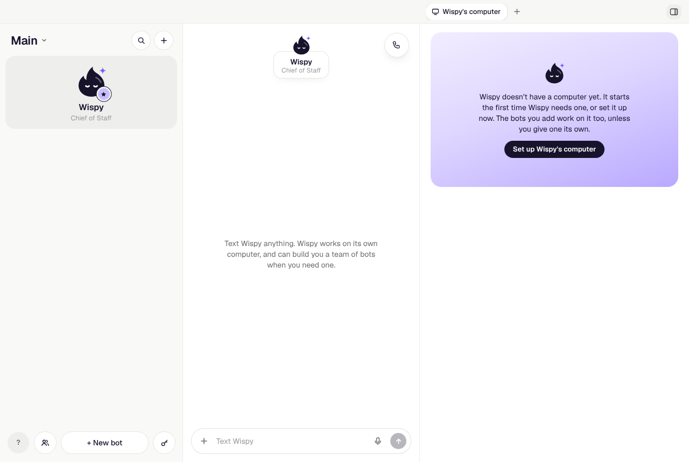

<h1 align="center">Deskwisp</h1>

<p align="center">
  <b>Business ops, run by bots, on Windows.</b><br>
  A team of AI bots that works for you on real computers. Chat with them like teammates, from your PC or your phone, and they get the work done.
</p>

<p align="center">
  <a href="#download"><b>Download for Windows</b></a>
  &nbsp;·&nbsp;
  <a href="#plans">Plans</a>
  &nbsp;·&nbsp;
  <a href="#roadmap">Roadmap</a>
  &nbsp;·&nbsp;
  <a href="#run-it-yourself">Self-host</a>
</p>

<p align="center">
  
  <a href="LICENSE"></a>
</p>

<p align="center">
  <b>A personal Windows port of <a href="https://github.com/Horafirm/deskwisp">Deskwisp</a>.</b> Same code, same license (FSL-1.1-ALv2), adapted to run on Windows and to be driven from Android or iPhone.<br>
  The license rules out offering it as a competing product or hosted service, and each version becomes Apache 2.0 two years after its release. <a href="#license">Details</a>
</p>

<p align="center">
  <b>Windows port by <a href="https://github.com/Ossamahendi21">@Ossamahendi21</a></b><br>
  Based on Deskwisp, created by <a href="https://github.com/nickvasilescu">Nick Vasilescu</a> and developed with <a href="https://deskwisp.com">Horafirm</a>
</p>

<br>

Deskwisp is a Windows app that gives you a team of AI bots for your business ops: inbox, pipeline, invoices, reports. They work on cloud computers you can watch live and take over at any time. Reach them in the app and in Slack, Telegram and Discord, and on Pro and Max by text, call or email. They remember who you are and what they did yesterday.

<p align="center">
  
</p>

- **Watch or take over.** Watch any screen live, take control, then hand it back.
- **Asks before it acts.** Reading runs at once. Sending, creating and paying wait for your OK.
- **Your apps, your rules.** About 1,400 apps, several accounts each. Each bot gets only the access you give it.
- **Where your team works.** Ask in Slack, Telegram or Discord, and the answer comes back there.

## What your bots can do

- **Work on real computers.** Your bots work on a cloud computer from [Horafirm](https://deskwisp.com): 4 cores, 16 GB RAM and 4 screens, with Chrome, LibreOffice, GIMP and Inkscape. Watch any screen live, or take over. On Free and Pro all your bots share one computer. Max gives you up to 3.
- **Work as a team.** A main bot (Wispy, unless you rename it) runs the team and hands work to the specialists you add. Bots talk to each other, keep threads and report back in the chat. Each workspace is its own team.
- **Remember.** What you tell your bots, they remember, per workspace, on every channel.
- **Use your apps.** Connect Gmail, Calendar and any of about 1,400 apps, with several accounts each. Reading runs at once. Sending, creating or paying asks you first. A bot set to Just do it sends and changes things without asking, and still asks before paying.
- **Look things up.** Companies, people, work emails (checked before they're used), phones, company news, hiring and funding, and local businesses, for cents a lookup. A pricier lookup asks you first, and so does emailing someone a bot found, even on Just do it.
- **Answer email.** On Pro and Max, your main bot has its own email address. Email it a task, and it emails back when it's done.
- **Take texts and calls.** On Pro and Max, your main bot has its own phone number. Text it like a person, or call it and talk live. It hands off work while you talk, and texts you the results. Only you can give it work: anyone else who calls gets a bot that takes a message.
- **Talk in the app.** Call any bot by voice, or use the mic in the chat.
- **Control it from your phone.** Add a bot to Telegram, Discord or Slack and give it work from Android or iPhone. It answers when it's mentioned and takes requests only from you.
- **Work on your PC, too.** A bot can browse in a Chrome of its own on your PC, so sites see your home connection. (Tasks that run a shell on your PC aren't on Windows yet.)
- **Sign in safely.** Logins live in the Vault: passwords and 2FA keys are sealed on your PC with AES-256 and Windows DPAPI, and no model ever sees them.
- **Keep an eye on things.** Routines and reminders run on a schedule. A bot can watch a screen, like an inbox or a dashboard, and tell you when something there needs you.
- **Make things.** Bots draw and edit pictures right in the chat, and files they link open in the app.

Deskwisp runs on your PC: keep it on for routines, watches, and Telegram or Discord. While it's away, callers to your bot's number get a bot that takes a message.

Coming soon: WhatsApp, and a free self-hosted computer for the bots on your own server.

## Plans

When you sign in with Horafirm, the app uses Deskwisp' hosted service, and Deskwisp' plans apply. Every plan includes a computer for the bots: 1 on Free and Pro, up to 3 on Max. On Free and Pro, all your bots share that one computer. AI credit pays for what your bots do, billed at cost.

| | **Free** | **Pro** | **Max** |
|---|---|---|---|
| Price | $0 | $20 a month | $200 a month |
| Computers | **1 computer included**<br>10 hours a month, 4 cores, 16 GB RAM, multi-screen | **1 computer included**<br>Always on, 4 cores, 16 GB RAM, templates, multi-screen | **Up to 3 computers**<br>Always on, 4 cores, 16 GB RAM each |
| AI credit | $5 of AI credit, once | $20 of AI credit every month | $200 of AI credit every month |
| Bots | As many as you like, all sharing that one computer | As many as you like, all sharing that one computer | As many as you like, across up to 3 computers |
| Phone numbers and emails | No phone number or email | 1 phone number and 1 email | Up to 5 phone numbers and 5 emails |

- Free's computer gets 10 hours a month. It sleeps when nobody is using it, so the hours last. Account and usage shows the hours used this month and when they start over.
- Need more AI credit? Add some any time, $5 to $1,000, in Account and usage. It's a one-time charge, never automatic.
- Pro and Max credit doesn't carry over from month to month. When credit runs out, tasks stop cleanly.
- Pick or change a plan in the app, in Account and usage.
- Plans, prices and the hosted service are Horafirm's, not this port's; they may change.

Running it yourself on your own keys? These plans don't apply: you pay each provider directly, and your Horafirm plan sets how many computers you can run. See [Run it yourself](#run-it-yourself).

## Download

1. Build the installer (see [Releasing the Windows app](#releasing-the-windows-app)), or use one you built before: `dist-win\Deskwisp-Setup-<version>-x64.exe`. It runs on Windows 10 and 11, x64.
2. Run it. The build isn't signed, so Windows SmartScreen asks once: **More info → Run anyway**.
3. Sign in with Google, with your email, or with Horafirm. If you don't have an Horafirm account yet, one is made for you.
4. Say hi to Wispy, your main bot. It takes it from there.

The installer is per-user (no admin needed), adds Start menu and desktop shortcuts, and lets you pick the install folder. Updates: build the new version and run its installer over the old one; your data stays.

## Roadmap

What's coming next for this port:

- **A free computer for the bots.** A small server for your own VPS that answers the same API as Horafirm's computers (Docker, Xvfb, Chromium, xdotool), so the bots can work without a paid plan.
- **WhatsApp.** Reach your bots where most people already are.
- **Shell tasks on Windows.** The tasks that run on your own PC with a shell, which today are written for another system.

## Credits

Deskwisp is a Windows port of [Deskwisp](https://github.com/Horafirm/deskwisp), maintained by [@Ossamahendi21](https://github.com/Ossamahendi21).

Deskwisp was created by [Nick Vasilescu](https://github.com/nickvasilescu) ([@nickvasilescu](https://github.com/nickvasilescu)). It started as his open-source project and is now developed with [Horafirm](https://deskwisp.com). See [AUTHORS](AUTHORS) and [CITATION.cff](CITATION.cff). Thanks to everyone who has reported a bug, sent a fix or shared an idea to the original: see its [contributors](https://github.com/Horafirm/deskwisp/graphs/contributors).

## Built with

- [Horafirm](https://deskwisp.com): the bots' cloud computers
- [OpenAI](https://openai.com): chat, tasks and voice
- [Honcho](https://honcho.dev): long-term memory
- [Composio](https://composio.dev): connected apps
- [treg](https://treg.to): business data
- [AgentMail](https://agentmail.to): the bots' email
- [AgentPhone](https://agentphone.ai): phone numbers, texts and calls
- [TypeSafe](https://typesafe.ai): small yes or no judgments

The app itself is Electron and Next.js.

---

## How it works

- **The app** (`desktop/win-main.cjs`, Electron) starts the **server** (Next.js: `app/` and `lib/server/`) on your PC, on port 3210, with Electron's own Node. The server runs the team: chats, threads, routines, watches and the bots' tasks.
- **The bots' computers** are Horafirm cloud computers, launched from a template built from this repo (`horafirm/`, with what runs on them in `vm/`).
- **Tasks on the bots' computers** run on OpenAI's computer tool (Responses API).
- **Signed in with Horafirm**, the app works through Deskwisp Cloud (`cloud/`), the server Horafirm runs for hosted Deskwisp. Horafirm's provider keys stay there, and your PC gets only narrow ones. Deskwisp Cloud also takes the webhooks for texts, calls and Slack, and keeps your chats in your account.
- **Self-hosted** (`DESKWISP_SELF_HOSTED=1`), the app calls each provider directly with the keys in `.env.local` and keeps its state in `%APPDATA%\Deskwisp\data`. A small relay (`edge/`) can give the webhooks a public HTTPS address.

## Run it yourself

### Requirements

- Windows 10 or 11 (x64), Node 22 or newer, and Git Bash.
- **Required:** an [Horafirm](https://deskwisp.com) account and an OpenAI API key, plus a second, restricted OpenAI key with a spend limit for tasks (`OPENAI_EXECUTOR_API_KEY`).
- **Recommended:** TypeSafe (small judgment calls), Honcho (memory), Composio (apps), treg (business data), AgentMail (email), Tailscale (a direct live view of the bots' screens).
- **Optional:** AgentPhone and a public URL, for texts and calls.
- **For the bots' Chrome on your PC:** Google Chrome (found on its own, or set `DESKWISP_CHROME` to `chrome.exe`).

### Start it

```bash
npm ci                       # dependencies
npm run app:win              # opens the app, which starts `next dev` on port 3210
```

Put your settings in `%APPDATA%\Deskwisp\.env.local` (or `.env.local` in the source folder for `next dev`): at least `OPENAI_API_KEY` and `OPENAI_EXECUTOR_API_KEY`, and `HORAFIRM_API_KEY` to skip signing in. Or leave `DESKWISP_SELF_HOSTED` unset and sign in with Horafirm: Deskwisp Cloud then calls the providers, and you need no keys of your own.

Or run the server alone with `npx next dev --port 3210 -H 127.0.0.1` and open http://127.0.0.1:3210.

The app opens on sign-in: **Continue with Google**, **Continue with email** or **Sign in with Horafirm**. With `DESKWISP_SELF_HOSTED=1` and `HORAFIRM_API_KEY` set, it skips this and uses your key. Then open **Settings → You** and add your name and a line about yourself: every bot uses it.

### Settings

`.env.example` lists every setting with a note on each. The ones that matter most:

| Setting | What it's for |
|---|---|
| `DESKWISP_SELF_HOSTED=1` | Call each provider directly with your own keys, and show the Self-hosting section in Settings. |
| `OPENAI_API_KEY` | Chat, calls, and tasks on the bots' computers. Required. |
| `OPENAI_EXECUTOR_API_KEY` | The key the bots' tools run with. Use a restricted key with a spend limit; it can be in the same OpenAI project. Required. |
| `HORAFIRM_API_KEY` | The bots' cloud computers. Optional: set it to skip signing in with Horafirm. |
| `DESKWISP_HORAFIRM_ORIGIN` | Point the bots' computers at another server with the same API (a self-hosted one). |
| `TYPESAFE_API_KEY` | Small yes or no judgments: is this risky, which bot should take it. |
| `HONCHO_API_KEY` | Long-term memory. |
| `COMPOSIO_API_KEY` | Connected apps. |
| `TREG_TOKEN` | Business data. |
| `AGENTMAIL_API_KEY`, `DESKWISP_MAIL_DOMAIN` | The bots' email, on a domain you've verified in AgentMail. |
| `TAILSCALE_AUTH_KEY` | Lets the bots' computers join your tailnet for a direct, private live view. |
| `AGENTPHONE_*`, `DESKWISP_AGENTPHONE_HOOK_URL` | Phone numbers, texts and calls. See [Texts and calls](#texts-and-calls). |
| `TWILIO_VERIFY_SERVICE_SID`, `TWILIO_API_KEY_SID`, `TWILIO_API_KEY_SECRET` | Sends a code that proves a mobile number or email address is yours. |
| `DESKWISP_PUBLIC_URL` | Your relay's public address (`edge/`): where people land after connecting an app, OAuth callbacks, and the bots' pictures. |
| `DESKWISP_SLACK_*` | Your own Slack app. `slack/setup.mjs` makes it and fills these. Set `DESKWISP_PUBLIC_URL` first, and change the OAuth redirect in `slack/manifest.json` to your relay. Without them, Slack goes through Composio's app. |
| `DESKWISP_DATA_DIR` | Keep the app's data somewhere other than `%APPDATA%\Deskwisp\data`. |
| `DESKWISP_CHROME` | Path to `chrome.exe`, if it isn't found on its own. |
| `DESKWISP_VAULT_KEY` | The vault's key (32 bytes, base64) instead of one sealed with DPAPI: for a server, not your PC. |

Telegram and Discord need no settings: you paste each bot's token in the app, and it's kept in the Vault.

### The bots' computers

Bot computers launch from an Horafirm template built from this repo. By default they use Horafirm's public copy, which every account has. To build your own, run `node horafirm/deskwisp-base.mjs publish` and set `DESKWISP_HORAFIRM_TEMPLATE` to its ref.

The app keeps its computers in one Horafirm workspace: the signed-in user's workspace named "deskwisp", or `DESKWISP_HORAFIRM_WORKSPACE` when self-hosting on `HORAFIRM_API_KEY`. It never creates or deletes computers outside it.

### Texts and calls

Optional, for self-hosting:

1. Deploy `edge/`, a small relay that forwards webhooks to your PC over Tailscale. `edge/fly.toml` has a config for Fly: set your own app name in it. The relay needs a Tailscale login and `DESKWISP_UPSTREAM`, your PC's tailnet address on port 3210.
2. Point your AgentPhone webhook at `/hooks/agentphone` on the relay. Texts and calls both arrive there.
3. Set the `AGENTPHONE_*` settings and `DESKWISP_AGENTPHONE_HOOK_URL`, then add your mobile in **Settings → How your bots reach you**.

The relay also takes `/hooks/slack` for your own Slack app, and `/hooks/openai` for a number you route to an OpenAI SIP trunk yourself (with `OPENAI_WEBHOOK_SECRET`). Every webhook is signature-checked. US texting needs an A2P 10DLC registration for your brand.

The installed app's server listens on 127.0.0.1 only. To let webhooks reach it over the tailnet, add `DESKWISP_LISTEN_ALL=1` to `%APPDATA%\Deskwisp\.env.local`. Other addresses can then reach only the webhook paths and the bots' computers' calls, each of which proves itself.

## Releasing the Windows app

```bash
npm run app:win:release     # or: bash scripts/release-win.sh
```

It builds the server (Next.js standalone), keeps only what the server needs, turns the few links Next makes into real copies (links don't survive a Windows installer), and starts the server once with no keys to check that the page and its state answer. Then it packs it with Electron into `dist-win/Deskwisp-Setup-<version>-x64.exe`, an NSIS installer.

- It runs on Windows (Git Bash), and also on Linux or macOS with Wine installed (the installer step needs it there).
- It isn't signed. To sign it, give electron-builder a code-signing certificate (`CSC_LINK` and `CSC_KEY_PASSWORD`).
- The config is `electron-builder.win.json`; the app's window and server start are in `desktop/win-main.cjs`.

The installed app keeps its files in `%APPDATA%\Deskwisp`: `data\` (state and the sealed vault), `.env.local` (your settings), `window-token`, and `logs\main.log` and `logs\server.log`.

## What changed for Windows

| Area | Change |
|---|---|
| Vault | Secrets are sealed with AES-256-GCM in `data\vault.sealed`; its key is sealed with Windows DPAPI for your Windows user (`lib/server/keychain.ts`). On a Mac it still uses the Keychain. |
| Platform | The server reads the platform when it starts (`lib/server/platform.ts`): the build had baked in the platform of the machine that built it. |
| Desktop shell | `desktop/win-main.cjs`: starts the server with Electron's Node, keeps data in `%APPDATA%`, Windows' window buttons over the title bar, screens through `desktopCapturer`, a clean stop that saves first. |
| Your PC's Chrome | Found under Program Files or your AppData, with a Windows user agent; bot Chromes are closed by their profile on account switches (`lib/server/local.ts`). |
| Links | Open in your default browser on Windows (`lib/server/composio.ts`). |
| Data folder | Settable with `DESKWISP_DATA_DIR` (`lib/server/user-paths.ts`). |
| Fonts | Geist from the `geist` package, so the build works offline (`app/layout.tsx`). |
| Build | `electron-builder.win.json`, `scripts/release-win.sh`, `build/icon.ico`. |

## Project layout

| Path | What's there |
|---|---|
| `app/` | Next.js routes: the UI and `app/api/*` |
| `components/app/` | The app's UI. `components/message-ui/` is the chat kit. |
| `lib/server/` | Everything server-side: chat engine, sessions, providers, state |
| `lib/plan-includes.ts` | What each plan includes, in the words the app shows |
| `desktop/` | The Electron shells: `win-main.cjs` (Windows) and `main.cjs` (the original Mac app) |
| `vm/` | What runs on the bots' computers: screen MCP, browser helpers |
| `horafirm/` | The Horafirm template builder |
| `cloud/` | Deskwisp Cloud, the server for hosted Deskwisp |
| `db/` | The Postgres schema for hosted Deskwisp |
| `edge/` | The webhook relay for self-hosting |
| `slack/` | The Slack app |
| `site/` | The original project's website |
| `docs/` | Images and what's new in each version of the original (`docs/releases/`) |

## Contributing

This is a personal port. Bugs that are about Windows belong here; anything else is best reported to the original project, [Horafirm/deskwisp](https://github.com/Horafirm/deskwisp).

Before you commit:

```bash
npx next typegen        # route types (next-env.d.ts isn't committed)
npx tsc --noEmit -p .
npm run lint
```

## Privacy

Signed in with Horafirm, the app sends Horafirm usage events through PostHog, the analytics service deskwisp.com uses: the app opening, a bot being made, a message sent or a task finished (counted, never read), a plan changing, and errors in the app's own code (the error's type and where in the code it happened, never its message). They are tied to your Horafirm account and never include what you or your bots write, say or see: no messages, emails, files, contacts, phone numbers, web addresses, screens or keys. The app's window also sends device details: OS, screen size, time zone, a device id and approximate location from your IP. It doesn't record your screen or your sessions. Turn it off for all your devices in **Settings → You → Share usage data**, or on one PC with `DESKWISP_TELEMETRY=0` or `DO_NOT_TRACK=1` in `%APPDATA%\Deskwisp\.env.local`. Self-hosted (`DESKWISP_SELF_HOSTED=1`), it sends nothing. Every event and property is listed in [`cloud/analytics-rules.ts`](cloud/analytics-rules.ts). See Horafirm's [Privacy Policy](https://app.deskwisp.com/privacy) and [subprocessors](https://app.deskwisp.com/subprocessors).

## Security

- The server trusts requests from your PC. Don't expose port 3210 to the internet. To use your bots from your phone, use Telegram, Discord or Slack, or a private network such as Tailscale.
- The installed app's server listens on 127.0.0.1 only. With `DESKWISP_LISTEN_ALL=1`, or in development (`next dev` without `-H 127.0.0.1`), other devices on your network can reach it: keep that network to your own devices.
- Signed in with Horafirm, provider keys stay on Deskwisp Cloud and webhooks come in through it. Self-hosted, keys live in `.env.local` and webhooks go public through `edge/`, each one signature-checked.
- Saved logins live in the sealed vault on your PC. Neither keys nor logins are sent to the window or to a model.
- The bots' tools run on `OPENAI_EXECUTOR_API_KEY`. Give it a spend limit.
- Found a vulnerability in the original code? Report it privately to its authors, as [SECURITY.md](SECURITY.md) describes.

## License

This port keeps the original's license. Deskwisp is [fair source](https://fair.io): the code is public, and you can read it, run it, change it and share it. It's under the [Functional Source License, Version 1.1, ALv2 Future License](LICENSE) (FSL-1.1-ALv2, [about FSL](https://fsl.software)). Here it is in plain words; the [LICENSE](LICENSE) has the exact terms, and they're what count.

- **Use it for anything but competing with it.** At home or at work: inside your company, for teaching and research, and in services you provide to people who use Deskwisp under these terms.
- **Don't offer it as a competing product.** You may not make it available to others in a commercial product or service that replaces Deskwisp (or one of its makers' products built with it), or that does substantially the same thing, such as a hosted Deskwisp.
- **Keep the license with it.** The same terms cover copies, changes and forks, this one included. When you share them, include the license (or a link to it) and keep the copyright notices.
- **Each version becomes Apache 2.0.** Two years after a version's release, that version is also available under the Apache License 2.0, with no limit on competing.

The license also grants the authors' patents for these uses (until you sue someone claiming the software infringes a patent), and it comes as is, with no warranty.

| Can I… | |
|---|---|
| Run it for myself, or across my company? | Yes. |
| Change it and share my version? | Yes, under the same license, with a different name and logo ([TRADEMARK.md](TRADEMARK.md)). |
| Build my own product with it? | Yes, as long as that product doesn't compete with Deskwisp (above). |
| Offer it hosted, or sell an app that does what Deskwisp does? | Not under FSL. Each version allows it two years after its release, under Apache 2.0. |

Some code comes from other projects, under their own licenses: `components/message-ui/` is adapted from [imessage-ui](https://github.com/theswerd/imessage-ui) (MIT). See [THIRD_PARTY_NOTICES.md](THIRD_PARTY_NOTICES.md).

"Deskwisp", the Deskwisp logo and the bot mascots are trademarks of Organic Intelligence, Inc. The license covers the code, not the name or logo. Deskwisp is not affiliated with or endorsed by Organic Intelligence, Inc. or Horafirm. See [TRADEMARK.md](TRADEMARK.md).
