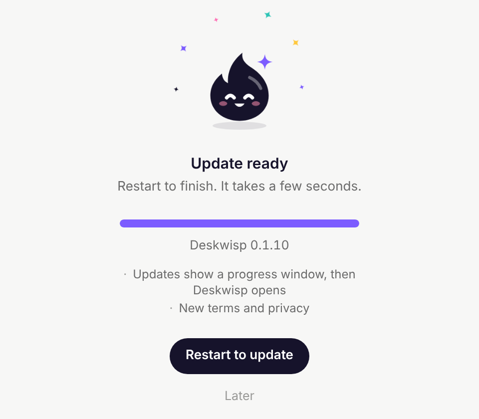
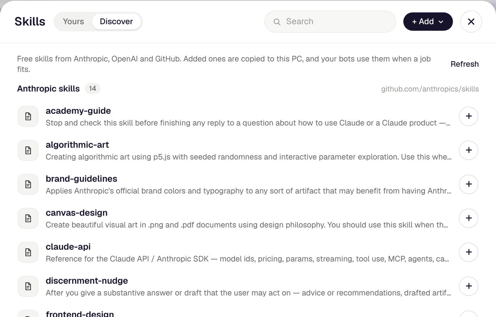
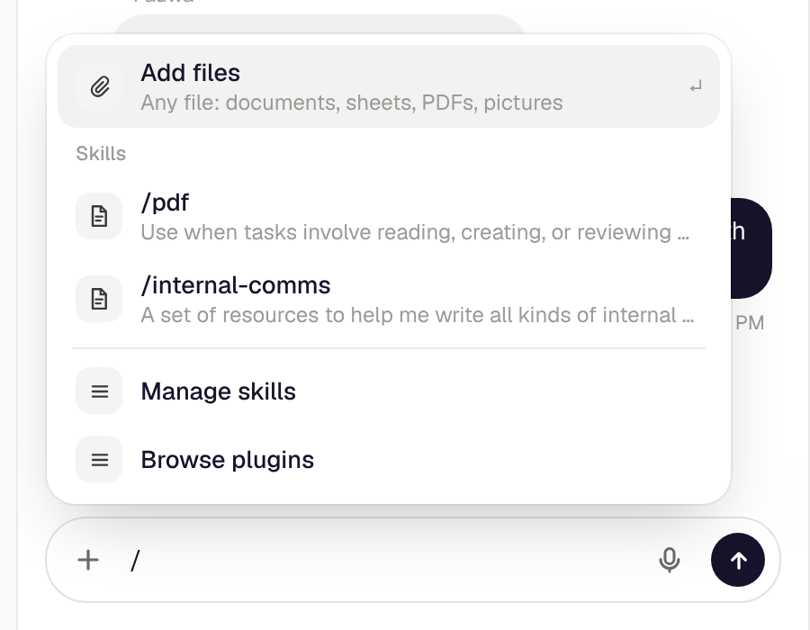
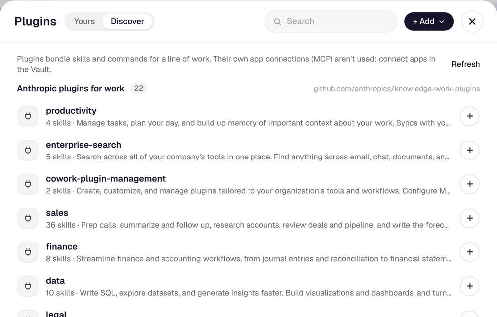
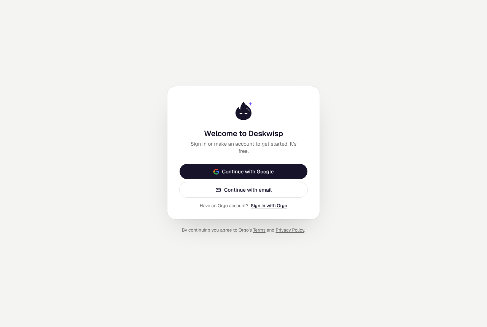

<h1 align="center">Deskwisp</h1>

<p align="center">
  <b>AI employees that run your back office, on Windows.</b><br>
  A team of AI agents for your small business. Each one works on its own computer, with its own email and memory. Ask in a chat, and the work gets done. Nothing goes out without your OK.
</p>

<p align="center">
  <a href="https://deskwisp.com/download/Deskwisp-Setup.exe"><b>Download for Windows</b></a>
  &nbsp;·&nbsp;
  <a href="https://apps.microsoft.com/detail/9N9QZ5QT9Q2N">Microsoft Store</a>
  &nbsp;·&nbsp;
  <a href="https://deskwisp.com">deskwisp.com</a>
  &nbsp;·&nbsp;
  <a href="#plans">Plans</a>
  &nbsp;·&nbsp;
  <a href="#whats-new-in-0110">What's new</a>
  &nbsp;·&nbsp;
  <a href="#roadmap">Roadmap</a>
</p>

<p align="center">
  
  
  
</p>

<p align="center">
  <a href="https://apps.microsoft.com/detail/9N9QZ5QT9Q2N?referrer=appbadge&mode=direct"></a>
</p>

<br>

<p align="center">
  
</p>

Deskwisp is a Windows app that gives your business a team of AI bots. Wispy, your main bot, runs the team and hands work to the specialists you add: a bookkeeper, a salesperson, customer support, anyone you need. They work on a cloud computer you can watch live and take over at any time. Reach them in the app, by email, by text or iMessage, by voice, and in Telegram, Discord and Slack. They remember your customers, your prices and how you like things done.

- **Does the work, not just the talking.** A bot opens the apps and websites it needs, writes and files things, and tells you when it's done.
- **Asks before it acts.** Looking things up runs at once. Sending, buying and deleting wait for your OK.
- **Watch or take over.** Watch any screen of the bots' computer live, take the mouse, then hand it back.
- **One team, everywhere.** The same bots and the same memory in the app, your inbox, your phone and your team's chat.

## What's new in 0.1.10



- **Updates you can see.** When a new version is ready, Deskwisp says so with what's new. Restart to update shows its progress, the installer shows its own, and Deskwisp opens again on the new version.
- **New terms and privacy.** Plain, short, and for everyone: [Terms](https://deskwisp.com/terms) and [Privacy](https://deskwisp.com/privacy).

From 0.1.9:

- **Skills and plugins**, from a free library or your own (see [Skills and plugins](#skills-and-plugins)).
- **Add files** to any chat: documents, sheets, PDFs and pictures, which a task gets on its computer too.
- **Memory that follows you.** What your bots remember is kept in your Deskwisp account, so a new PC (and soon the phone app) knows you from the start.
- **Right-click to paste**, cut and copy everywhere in the app.

<br clear="right">

## What your bots can do

- **Work on a real computer.** The bots share a cloud computer with Chrome, LibreOffice, GIMP and Inkscape, and up to 4 screens. It sleeps when nobody is using it, so only the time it works counts.
- **Work as a team.** Wispy runs the team and hands work to the bots you add. Bots talk to each other, keep threads and report back in the chat. Each workspace is its own team.
- **Remember.** Customers, prices, suppliers and how you like things done, kept across every chat and channel. **Orbit**, in the sidebar, shows what they know, sorted into sections: change or forget any of it, or tell it something new.
- **Use your apps.** Connect Gmail, Calendar and about 1,400 other apps, with several accounts each. Each bot gets only the access you give it. A bot set to **Just do it** sends and changes things without asking, and still asks before paying.
- **Look things up.** Companies, people, work emails (checked before they're used), phone numbers, company news, hiring and funding, and local businesses.
- **Answer email.** On Pro and Max, your main bot has its own work address. Forward it a thread or copy it in: it reads, does the work and replies.
- **Take texts and calls.** Give a bot a US or Canadian number on your own AgentPhone account, and people can text or call it. Text it yourself like a person, or on iMessage.
- **Talk.** Call any bot from the app and talk the task through, or use the mic in the chat.
- **Keep an eye on things.** Routines and reminders run on a schedule. A bot can watch a screen, like an inbox or a dashboard, and tell you when something needs you.
- **Sign in safely.** Logins live in the Vault: passwords and 2FA keys are sealed on your PC (AES-256, with a key Windows keeps for your user), and no model ever sees them.
- **Make things.** Bots draw and edit pictures right in the chat, and the files they make open in the app.

## Skills and plugins

<p align="center">
  
</p>

A **skill** is a set of instructions your bots follow for one kind of job: your weekly report, how you write quotes, your brand, how to fill a PDF. A **plugin** bundles skills and commands for a whole line of work, like sales, finance or customer support.

- **Discover** lists free skills and plugins from Anthropic, OpenAI and GitHub, and from any public GitHub repository you add. One click copies one to your PC, and your bots use it whenever a job fits.
- **Add** your own: upload a skill (a `SKILL.md`, or a `.zip` of its folder) or a plugin (a `.zip`), or write a skill in the app.
- **Type `/` in a chat** to use a skill now, or to add files.

<table>
  <tr>
    <td width="50%"></td>
    <td width="50%"></td>
  </tr>
</table>

## Reach your bots anywhere

| Where | How |
|---|---|
| The app | Chat with any bot, call it by voice, add files, watch its computer. |
| Email | Your main bot's work address (Pro and Max). It replies by email when it's done. |
| Text and iMessage | A number on your own AgentPhone account. Only you can give it work: anyone else who texts or calls gets a bot that takes a message. |
| Telegram, Discord, Slack | Add a bot and give it work from your phone or your team's chat. It answers when it's mentioned. |
| Your phone | Add your mobile in **Settings → How your bots reach you**, and your bots text you results. |

Deskwisp runs on your PC: keep it open for routines, watches, Telegram and Discord.

## Plans

As many bots as you like on every plan. You pay for the computer time and AI credit they use, not per seat.

| | **Free** | **Pro** | **Max** |
|---|---|---|---|
| Price | $0 | $29 a month | $199 a month |
| AI credit | $1 every month | $10 every month | $100 every month |
| Computer hours | 10 a month | 60 a month | 300 a month |
| The computer | 1, with 1 screen per bot: each bot works on one thing at a time | 1, with 2 screens per bot: two things at once | 1, with 4 screens per bot: four things at once |
| Email for your bots | None | An address for your main bot | Up to 5 addresses |
| Share with people | None | 2 people | Up to 5 people |

- Pick or change your plan in the app, under **Account and usage**. Computer hours and credit start over each month.
- Need more AI credit? Add some any time, from $5 to $1,000. It's a one-time charge, never automatic, and it doesn't expire.
- When credit runs out, the bots stop cleanly, and the tasks they stopped carry on by themselves once there's credit again.
- Phone numbers, texts and calls are on your own AgentPhone account, paid to AgentPhone.

## Download



1. Download [Deskwisp-Setup.exe](https://deskwisp.com/download/Deskwisp-Setup.exe) from deskwisp.com. It runs on Windows 10 and 11, 64-bit.
2. Run it. The installer isn't signed yet, so Windows SmartScreen asks once: **More info → Run anyway**.
3. Sign in with Google or with your email. You start on Free.
4. Say hi to Wispy. It takes it from there.

Or get it from the **Microsoft Store**: [Deskwisp in the Store](https://apps.microsoft.com/detail/9N9QZ5QT9Q2N). It installs without the SmartScreen question, and the Store keeps it up to date. The two are separate apps with separate data, so pick one.

The installer is per-user (no admin needed) and adds Start menu and desktop shortcuts. Deskwisp updates itself: it finds a new version within the hour and offers it the next time it opens. Your bots, chats and settings stay.

<br clear="right">

## Roadmap

- **Android app.** Your bots, chats and memory on your phone. The app already has a place for it (the Phone tab says Coming soon).
- **WhatsApp.** Reach your bots where most people already are.

---

## How it works

| Part | Where | What it does |
|---|---|---|
| The app | `desktop/win-main.cjs` (Electron) | The window, updates, the Vault, and the server below, started with Electron's own Node. |
| The app's server | `app/`, `lib/server/` (Next.js, port 3210, on 127.0.0.1) | Runs the team: chats, threads, routines, watches and the bots' tasks. |
| Deskwisp accounts and computers | `dcloud/` (`app.deskwisp.com`) | Sign-in (Clerk), the bots' computers (E2B), plans, AI credit, computer hours, people. |
| Deskwisp services | `cloud/` (`cloud.deskwisp.com/api`) | Holds the provider keys, passes the app's calls on and counts each one against your AI credit. Takes the webhooks for email, texts, calls and Slack, and keeps your chats and memory in your account. |
| The bots' computers | `vm/`, `horafirm/` | What runs on each computer (screens, Chrome, helpers) and the template it starts from. |
| The website | `deploy/vps/site/` | deskwisp.com, with the terms and privacy pages. |

Users never hold a provider key. [docs/SERVICES.md](docs/SERVICES.md) says what runs where and what each costs, and [docs/DEPLOY.md](docs/DEPLOY.md) how the servers are set up.

### Built with

[OpenAI](https://openai.com) (chat, tasks and voice), [E2B](https://e2b.dev) (the bots' computers), [Clerk](https://clerk.com) (sign-in), [Neon](https://neon.tech) (Postgres), [Polar](https://polar.sh) (payments), [Composio](https://composio.dev) (connected apps), [AgentMail](https://agentmail.to) (the bots' email), [AgentPhone](https://agentphone.ai) (numbers, texts and calls), [treg](https://treg.to) (business data), [TypeSafe](https://typesafe.ai) (quick checks), and [Honcho](https://honcho.dev) (optional long-term memory). The app is Electron and Next.js.

## Run it yourself

### Requirements

- Windows 10 or 11 (x64), Node 22 or newer, and Git Bash.
- **Required:** an OpenAI API key, plus a second, restricted one with a spend limit for the bots' tools (`OPENAI_EXECUTOR_API_KEY`), and a computers server with its key (`DESKWISP_HORAFIRM_ORIGIN`, `HORAFIRM_API_KEY`), such as your own `dcloud/`.
- **Recommended:** TypeSafe, Composio, treg, AgentMail, and Tailscale (a direct live view of the bots' screens).
- **Optional:** AgentPhone and a public URL, for texts and calls. Honcho, for memory beyond Deskwisp's own.

### Start it

```bash
npm ci              # dependencies
npm run app:win     # opens the app, which starts `next dev` on port 3210
```

Put your settings in `%APPDATA%\Deskwisp\.env.local` (or `.env.local` in the source folder for `next dev`). With `DESKWISP_SELF_HOSTED=1` and your keys, the app calls each service directly and skips signing in. Leave it empty to sign in to Deskwisp instead, with no keys of your own.

Or run the server alone with `npx next dev --port 3210 -H 127.0.0.1` and open http://127.0.0.1:3210.

### Settings

`.env.example` lists every setting with a note on each. The ones that matter most:

| Setting | What it's for |
|---|---|
| `DESKWISP_SELF_HOSTED=1` | Call each service directly with your own keys. |
| `OPENAI_API_KEY` | Chat, calls, and tasks on the bots' computers. Required. |
| `OPENAI_EXECUTOR_API_KEY` | The key the bots' tools run with. Use a restricted key with a spend limit. Required. |
| `DESKWISP_HORAFIRM_ORIGIN`, `HORAFIRM_API_KEY` | The computers server, and your key for it. |
| `DESKWISP_HORAFIRM_TEMPLATE`, `DESKWISP_HORAFIRM_WORKSPACE` | The template the computers start from, and the workspace they're kept in. |
| `DESKWISP_CLOUD_URL` | Where Deskwisp's services are, when you run your own `cloud/`. |
| `TYPESAFE_API_KEY` | Quick yes or no checks: is this risky, which bot should take it. Without it, the app asks OpenAI. |
| `HONCHO_API_KEY` | Honcho for memory. Without it, the bots keep Deskwisp's own. |
| `COMPOSIO_API_KEY` | Connected apps. |
| `TREG_TOKEN` | Business data. |
| `AGENTMAIL_API_KEY`, `DESKWISP_MAIL_DOMAIN` | The bots' email, on a domain you've verified in AgentMail. |
| `AGENTPHONE_*`, `DESKWISP_AGENTPHONE_HOOK_URL` | Phone numbers, texts and calls. See [Texts and calls](#texts-and-calls). |
| `TAILSCALE_AUTH_KEY` | Lets the bots' computers join your tailnet for a direct, private live view. |
| `TWILIO_VERIFY_SERVICE_SID`, `TWILIO_API_KEY_SID`, `TWILIO_API_KEY_SECRET` | Sends a code that proves a mobile number or email address is yours. |
| `DESKWISP_PUBLIC_URL` | Your relay's public address (`edge/`): OAuth callbacks, links back into the app, the bots' pictures. |
| `DESKWISP_SLACK_*` | Your own Slack app (`slack/setup.mjs` makes it). Without them, Slack goes through Composio's app. |
| `DESKWISP_DATA_DIR` | Keep the app's data somewhere other than `%APPDATA%\Deskwisp\data`. |
| `DESKWISP_VAULT_KEY` | The Vault's key (32 bytes, base64) instead of one Windows keeps: for a server, not your PC. |

Telegram and Discord need no settings: you paste each bot's token in the app, and it's kept in the Vault.

### Texts and calls

1. Deploy `edge/`, a small relay that forwards webhooks to your PC over Tailscale (`edge/fly.toml` has a config for Fly).
2. Point your AgentPhone webhook at `/hooks/agentphone` on the relay. Texts and calls both arrive there.
3. Set the `AGENTPHONE_*` settings and `DESKWISP_AGENTPHONE_HOOK_URL`, then add your mobile in **Settings → How your bots reach you**.

The relay also takes `/hooks/slack` for your own Slack app, and `/hooks/openai` for a number you route to an OpenAI SIP trunk (with `OPENAI_WEBHOOK_SECRET`). Every webhook is signature-checked. The installed app's server listens on 127.0.0.1 only; add `DESKWISP_LISTEN_ALL=1` to let webhooks reach it over the tailnet.

## Releasing

```bash
printf '# Deskwisp 0.1.11\n\n- What changed\n' > docs/releases/v0.1.11.md
bash scripts/release-win.sh 0.1.11
git push
```

`scripts/release-win.sh` builds the server (Next.js standalone), checks that it starts, packs it with Electron into an NSIS installer (`dist-win/Deskwisp-Setup-<version>-x64.exe`), puts it on deskwisp.com, and commits and tags the version. Every installed Deskwisp finds it within the hour. The `- ` lines of `docs/releases/v<version>.md` are what the update window shows as what's new.

- It runs on Windows (Git Bash), and on Linux or macOS with Wine.
- Publishing needs SSH to the server, set in `.env.release` (never committed).
- The installer isn't signed. To sign it, give electron-builder a code-signing certificate (`CSC_LINK`, `CSC_KEY_PASSWORD`).

### The Microsoft Store package

```bash
bash scripts/release-store.sh       # after release-win.sh, on Windows (Git Bash)
```

It builds the same version as an MSIX package, `dist-store/Deskwisp-<version>-x64.appx`, to upload in Partner Center (Apps and games → Deskwisp → the submission → Packages). The Store signs it and keeps it up to date. The listing: [apps.microsoft.com/detail/9N9QZ5QT9Q2N](https://apps.microsoft.com/detail/9N9QZ5QT9Q2N).

- It's its own app beside the one from deskwisp.com: its own id (`HorafirmLLC.Deskwisp`, Store ID `9N9QZ5QT9Q2N`) and its own data, so the two never mix. It never runs Deskwisp's updater; About says its updates come from the Store.
- Its identity is the `appx` part of `electron-builder.win.json`, as Partner Center's Product identity page gives it. Its pictures are in `build/appx/` (`scripts/render-store-assets.mjs` draws them from the logo).
- Every package the Store gets needs a higher version than the last, so release a new version first.

The servers update with `cd /opt/deskwisp && sudo git pull && sudo bash deploy/vps/install.sh` ([docs/DEPLOY.md](docs/DEPLOY.md)).

The installed app keeps its files in `%APPDATA%\Deskwisp`: `data\` (state and the sealed Vault), `.env.local` (your settings), and `logs\` (`main.log`, `server.log`, `updates.log`).

## Project layout

| Path | What's there |
|---|---|
| `app/` | Next.js routes: the UI and `app/api/*` |
| `components/app/` | The app's UI. `components/message-ui/` is the chat kit. |
| `lib/server/` | Everything server-side: chat engine, threads, services, state, memory, skills |
| `lib/plan-includes.ts` | What each plan includes, in the words the app shows |
| `desktop/` | The Electron shells (`win-main.cjs` for Windows), the updater and the update window |
| `build/appx/` | The Microsoft Store package's pictures |
| `build/installer.nsh` | The installer's own steps (updates, logs) |
| `dcloud/` | Deskwisp accounts and computers |
| `cloud/` | Deskwisp services |
| `db/` | The Postgres schema and migrations for the services |
| `vm/`, `horafirm/` | What runs on the bots' computers, and their template |
| `edge/`, `slack/` | The webhook relay for self-hosting, and the Slack app |
| `deploy/vps/` | The server setup, and the website |
| `docs/` | Images, guides, and what's new in each version (`docs/releases/`) |

## Development

Before you commit:

```bash
npx next typegen        # route types (next-env.d.ts isn't committed)
npx tsc --noEmit -p .
npm run lint
```

Tests:

```bash
node --conditions=react-server scripts/test-<name>.mjs        # the app, one suite each
node --test "cloud/test/core-*.test.ts"                        # Deskwisp services (DESKWISP_TEST_DATABASE_URL: a test Postgres)
node --test "cloud/test/edge-*.test.ts" cloud/test/server.test.ts
cd dcloud && node --test                                       # Deskwisp accounts and computers
```

GitHub runs the checks and the services' tests on every push (`.github/workflows/`).

## Privacy

What Deskwisp keeps, and why, is in the [Privacy Policy](https://deskwisp.com/privacy); the rules for using it are in the [Terms](https://deskwisp.com/terms). In short:

- Your chats, memory and settings are kept in your Deskwisp account so they follow you to another PC. Your saved logins never leave your PC.
- The app sends no usage analytics today: Deskwisp has no analytics project of its own yet, so none leave. Every event it could ever send is listed in [`cloud/analytics-rules.ts`](cloud/analytics-rules.ts).
- You choose what each bot can reach: the apps, accounts, files and numbers you give it.

## Security

- The app's server listens on 127.0.0.1 only and trusts your PC. Don't expose port 3210 to the internet: to reach your bots from your phone, use Telegram, Discord, Slack, email or text.
- Signed in to Deskwisp, provider keys stay on Deskwisp's servers. Self-hosted, they live in `.env.local`, and webhooks go public through `edge/`, each one signature-checked.
- Saved logins live in the sealed Vault on your PC. Neither keys nor logins are sent to the window or to a model.
- Found a problem? Write to the address in [SECURITY.md](SECURITY.md).

## License

Copyright © 2026 Deskwisp. All rights reserved. This repository is private.

Some code comes from other projects, under their own licenses: `components/message-ui/` is adapted from [imessage-ui](https://github.com/theswerd/imessage-ui) (MIT). See [THIRD_PARTY_NOTICES.md](THIRD_PARTY_NOTICES.md).
